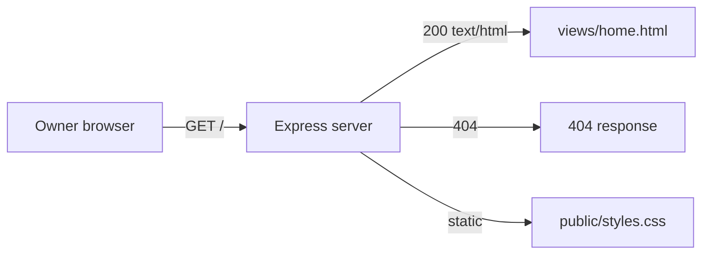

# Design: Repository Link Test

## Overview

Repository Link Test is a minimal Node.js Express web app with one home page. The owner starts it with `npm start` on their own computer and opens `http://localhost:3000` in a browser; the page displays the text "Repository Link Test" as its main heading. The app keeps no records, has no login, no database, no integrations and no deployment: it serves one fixed HTML document and nothing else.

The design covers the three requirements in `requirements.md`: showing the text on the home page (Requirement 1), starting the app on the owner's computer (Requirement 2), and recovering when the page does not load (Requirement 3).

## Architecture

One process, one route, one view.

- `server.js` creates the Express app, mounts the home route, mounts a 404 handler and starts listening on the port from `PORT` or `3000`.
- `app.js` builds and exports the Express app without listening, so tests can exercise it in-process.
- `views/home.html` holds the fixed HTML document with the text "Repository Link Test" as its `<h1>`.
- `public/styles.css` holds the page's styles.

There is no data layer, no session, no template engine and no external service. The page is a static HTML file read from disk and sent with `200`; the only dynamic value is the port the server listens on.

## Components and Interfaces

### `app.js` — the Express app

Exports the configured Express app. It:

- serves `public/` as static files under `/static`;
- answers `GET /` with `views/home.html`, sent as `text/html; charset=utf-8` with status `200`;
- answers any other path with status `404` and a short plain-text body.

The home route reads the HTML file once at startup and keeps it in memory, so a request does no disk read and answers well within the 2-second target of criterion 2.3.

### `server.js` — the entry point

Reads `process.env.PORT`, falling back to `3000`, and calls `app.listen(port)`. It logs the URL it listens on. `npm start` runs `node server.js`.

### `views/home.html` — the home page

A complete HTML5 document:

- `<html lang="en">` with a `<title>` of `Repository Link Test`;
- a `<main>` element holding one `<h1>` whose text content is exactly `Repository Link Test`;
- a `<link>` to `/static/styles.css`.

The text appears exactly once in the document body, in the `<h1>`, which satisfies criteria 1.2, 1.4 and 1.5. The document is plain semantic HTML with no script, so it works in any modern browser on desktop and phone and needs no build step.

### `public/styles.css` — the page styles

Centres the heading, sets a readable base font size and line height, and keeps the text legible on narrow screens. No layout framework and no external font.

### `package.json` — scripts and dependencies

- `start`: `node server.js`
- `dev`: `node server.js`
- `test`: `node --test`
- dependency: `express`
- dev dependency: `@playwright/test` (for the end-to-end journeys Greenfield's Tester saves in `e2e/`)

## Data Models

None. The app stores nothing: no database, no files written at runtime, no cookies and no session. The only state is the HTML string held in memory and the port the server listens on.

## Error Handling

- **Unknown path:** any request other than `/` (and the static files) gets status `404` with a short plain-text body, satisfying criterion 2.4.
- **Server not running:** the browser shows its own connection error; the app never serves a page without the text, satisfying criterion 3.1.
- **Reload:** every request to `/` re-sends the same in-memory document, so a reload shows the same page, satisfying criterion 3.2.
- **Restart:** `npm start` starts a fresh process that serves the same document, satisfying criterion 3.3.
- **Port already in use:** `app.listen` fails and the process exits with an error naming the port; the owner sets `PORT` to a free port, which criterion 2.2 allows.

## Testing Strategy

Two layers, both run by `npm test` with no server started by hand and no database:

1. **Unit and route tests** (`test/*.test.js`, run with `node --test`): start the exported app on an ephemeral port (`listen(0)`) inside the test, then check the home page's status, content type, the exact text and its single occurrence in the `<h1>`, the `404` for another path, and that the server honours a `PORT` value. These cover criteria 1.1–1.5, 2.1–2.5, 3.1 and 3.2.
2. **End-to-end journeys** (`e2e/`, run only through `run_journeys`): Playwright opens the running app at `/`, reads the heading, reloads the page and reads it again. These cover the owner's workflow W1 end to end.

The unit test runner leaves `e2e/` out, since those tests need the running app.

## Build and run
Install: npm install
Test: npm test
Run locally: yes
Dev: npm run dev
Port variable: PORT
Health path: /
Deploy: none

## Assumptions

- The home page is served from a static HTML file read at startup, since the text never changes and no template engine is needed.
- `npm start` and `npm run dev` both run `node server.js`; there is no build step and no watcher, because the app has one page.
- The health path is `/` itself: the app has no separate health endpoint, and `/` answers `200` whenever the server is up.
- The `404` body is plain text, since the app has no error page and the owner only ever opens `/`.
- Styles live in one stylesheet under `public/`, served by Express's static middleware, rather than inline in the HTML.
